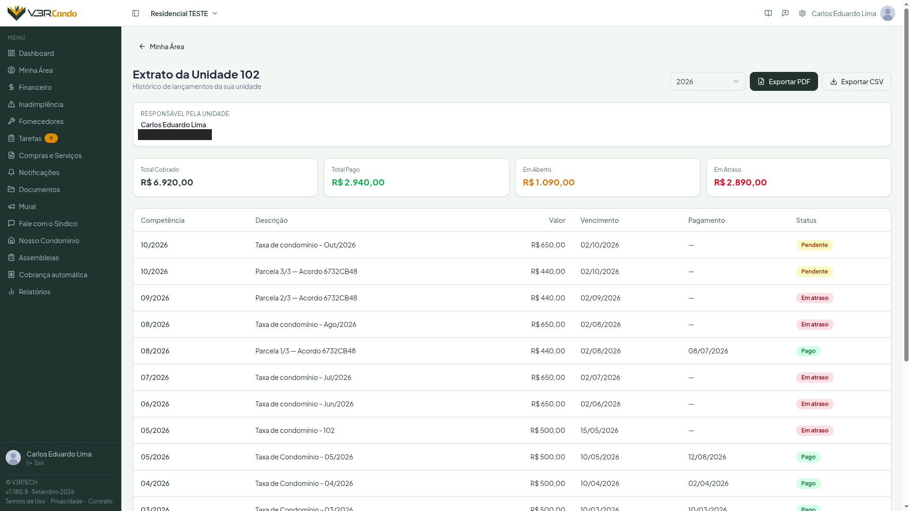

# Receber um morador novo

## Por que isto importa

Um morador que chega e não consegue entrar no aplicativo, ou entra e não encontra a própria unidade, começa a relação com o V3RCondo pelo lado errado — e volta a procurar o síndico pelos mesmos canais de sempre (WhatsApp, papel no elevador) que o aplicativo deveria substituir. Cadastrar direito da primeira vez evita isso: a pessoa certa, na unidade certa, com o histórico da unidade já esperando por ela.

Há três portas de entrada diferentes, e escolher a certa evita retrabalho.

## Passo a passo

### 1. Escolha como o morador vai entrar

| Situação | Caminho |
|---|---|
| Você tem o e-mail da pessoa e quer cadastrar na hora | **Adicionar condômino diretamente** |
| Você está recebendo vários moradores de uma vez — mudança de gestão, condomínio novo | **Importar planilha** |
| Você quer que os moradores peçam para entrar sozinhos, sem você cadastrar um por um | **Link ou QR do condomínio** — e depois **aprovar os pedidos** |

Todos os três caminhos ficam em [Configurações → Condôminos](/modulos/configuracoes/#aba-condôminos).

### 2a. Cadastro direto

Clique em **+ Adicionar condômino** e preencha nome completo, e-mail, unidade e título (Condômino, por padrão). O sistema cadastra a pessoa na hora e envia um e-mail de boas-vindas com instruções para definir a senha ou entrar com o Google.

### 2b. Importação por planilha

Clique em **Importar planilha**, baixe o modelo, preencha Nome, E-mail, Unidade e Título para cada morador e faça o upload. O sistema processa linha a linha, ignora e-mails já cadastrados e mostra um resumo com importados, ignorados e rejeitados — com o motivo de cada rejeição. Limite de 100 condôminos por importação; mais que isso, faça em duas levas.

### 2c. Link ou QR do condomínio

Em Configurações → Condôminos, no cartão **Link de entrada do condomínio**, clique em **Gerar link**. Mande o link pelo grupo do condomínio, ou **Baixe o QR** e imprima para o mural ou o elevador. Quem abre o link vê só o nome, a cidade e o estado do condomínio, entra (ou cria a conta), informa a unidade e envia o pedido. **Não existe busca de condomínio pelo nome:** sem o link, ninguém encontra o seu condomínio.

Você recebe um **e-mail a cada pedido**, e os pedidos aguardando aparecem **acima da lista**, em Configurações → Condôminos, no cartão **Pedidos de entrada pendentes**. **Confira a unidade** e clique em **Aprovar** — ou **Recusar**, se a pessoa não for de fato do condomínio. Dá para decidir vários de uma vez, marcando os pedidos (ou **Selecionar todos**) e usando **Aprovar selecionados** ou **Recusar selecionados**; a confirmação diz quantos pedidos serão afetados e o quadro **Resultado** mostra o que foi concluído, o que foi recusado por regra e o que falhou.

Quem você aprova **entra já confirmado** (não vê a janela **Confirmar / Não reconheço**, porque foi a própria pessoa que pediu) e recebe um e-mail de aviso. Se a unidade ainda não tinha responsável, a pessoa passa a ser a responsável.

{: .tip }
> **Cadastre as unidades antes de divulgar o link**
>
> Com as unidades cadastradas em **Configurações → Unidades**, o morador escolhe a dele numa lista e você evita pedido com unidade escrita errada. Sem unidades cadastradas, ele digita a unidade à mão.

{: .tip }
> **Imprimiu o QR? Teste, escreva uma frase ao lado e anote onde colou**
>
> Aponte o celular para o QR antes de imprimir, e escreva ao lado algo como *Moradores: aponte a câmera e peça a sua entrada*. Cole onde só morador passa (hall, elevador), não onde a rua enxerga: o link não expira, e qualquer pessoa que o abrir vê o nome, a cidade e o estado do condomínio. E anote os lugares — **Gerar outro link** invalida todos os QRs impressos, e você vai ter de reimprimir e recolar cada um. Mais detalhes em [Link de entrada do condomínio](/modulos/configuracoes/#link-de-entrada-do-condomínio-síndico).

{: .tip }
> **O link vazou? Gere outro**
>
> **Gerar outro link** desativa o anterior e o QR já impresso na hora; **Desativar** impede novos pedidos até você gerar um novo. Os pedidos que já chegaram continuam na lista. Condomínio ainda em análise ou suspenso não gera link.

{: .tip }
> **Convite por e-mail é outro caminho, sem solicitação a aprovar**
>
> Se você já cadastrou a pessoa pelo caminho 2a com o e-mail correto, e ela recebe o convite e clica no link, o vínculo é feito automaticamente — não sobra pedido pendente para aprovar.

### 3. Defina a unidade e o responsável

Uma unidade pode ter mais de um morador vinculado, mas só **um responsável** — é ele quem recebe notificações extrajudiciais e aparece nos documentos gerados para a unidade. Se o novo morador é quem deve constar como responsável, confirme isso em Configurações → Condôminos: o badge laranja **Responsável** marca quem está nessa posição hoje, e o botão **Transferir** troca para outra pessoa da mesma unidade quando for o caso.

### 4. O que o morador vê no primeiro acesso

Depois de criar a senha (ou entrar com o Google), o novo morador passa por até quatro telas, nesta ordem, antes de chegar ao Dashboard:

1. **Aceite dos Termos de Uso e da Política de Privacidade** — obrigatório, uma vez só (ou de novo, quando os documentos mudam de versão). Quem chega pelo convite por e-mail já marca esse aceite na tela de criar a senha e não o vê de novo ao entrar. Ver [Primeiros Passos — Aceitar os Termos de Uso](/guia/primeiros-passos/#aceitar-os-termos-de-uso-e-a-política-de-privacidade).
2. **Confirmação da inclusão** — uma janela pergunta *"O condomínio [nome] incluiu você na unidade [unidade]"*, com os botões **Confirmar** e **Não reconheço**. Não fecha até a pessoa responder. Até lá, você e os vizinhos veem só o nome que você digitou, e os dados do cadastro dela ficam ocultos.
3. **Complete seu cadastro** — pede telefone e CPF/CNPJ, se algum estiver em branco. Não é obrigatório; **Agora não** adia, e a janela não insiste mais de uma vez por semana.
4. **Seleção de condomínio** — só aparece se a pessoa tiver vínculo com mais de um condomínio.

Daí em diante, o morador vê o Dashboard com o resumo da própria unidade, e o menu lateral sem os módulos exclusivos do síndico.

### 5. Confira que a pessoa enxerga a própria unidade

Peça ao morador para abrir **Minha Área → Extrato da Unidade** e confirmar que o histórico da unidade (ou "sem lançamentos ainda", se a unidade for nova) aparece corretamente. É a prova de que o vínculo unidade↔morador está certo — não apenas que a conta foi criada.

## Exemplo concreto

A unidade 302 do Edifício Aurora foi vendida. O síndico cadastra o novo morador em **+ Adicionar condômino** com o e-mail dele e a unidade **302**, e transfere o badge de **Responsável** da antiga proprietária para o novo morador. O morador recebe o e-mail de boas-vindas, define a senha, aceita os Termos de Uso, preenche o CPF na janela de cadastro completo, e já vê no Extrato da Unidade os lançamentos em aberto daquele mês.

## Dicas e armadilhas

- **Um e-mail errado no cadastro direto vira um convite que nunca chega.** Confira o e-mail antes de salvar — não há como o app avisar que a pessoa nunca recebeu nada.
- **Se a pessoa já morou no condomínio antes, cadastre de novo com o mesmo e-mail** em vez de tentar "reativar" de outro jeito: o vínculo anterior é reaproveitado automaticamente, sem duplicar cadastro nem perder histórico.
- **Digite o nome certo da pessoa.** Até ela confirmar a inclusão, é o nome que você digitou que os outros moradores veem.
- **"Não reconheço" costuma indicar e-mail ou unidade errados.** A pessoa sai do condomínio e a lista mostra *Não confirmou a inclusão*; confira os dados e inclua de novo se foi engano. Cobranças já emitidas não são canceladas.
- **O que você digita no cadastro de quem ainda não confirmou pode ser apagado.** Se a pessoa responder "Não reconheço", o CPF, o telefone e os outros dados que você preencheu para ela somem do cadastro dela. Ao incluir de novo, será preciso preencher outra vez.
- **Pedido pendente não vence sozinho.** Um pedido esquecido fica ali indefinidamente — e o condomínio só comporta **30 pedidos aguardando**; passando disso, novos pedidos são recusados com um aviso. Vale conferir a lista de tempos em tempos, não só quando alguém reclama.
- **Quem fez pedido recebe e-mail ao ser aprovado ou recusado**, e acompanha a situação (**Aguardando o síndico** ou **Recusado**) na tela de escolha de condomínio. Cada pessoa pode fazer até 5 pedidos em 24 horas.

## Quando dá errado

| O que você vê | O que fazer |
|---|---|
| Morador diz que não recebeu o e-mail de boas-vindas | Confira o e-mail cadastrado em Configurações → Condôminos; se estiver certo, peça para checar a caixa de spam antes de recadastrar |
| Morador cadastrado, mas com a unidade vazia | Edite o membro (ícone de lápis) e preencha a unidade — sem ela, o morador não aparece nas listas por unidade nem no lançamento em lote |
| Duas pessoas aparecem como responsável pela mesma unidade | Não deveria acontecer — o sistema mantém sempre um único responsável por unidade; se você observar isso, é um comportamento a reportar |
| Pedido de alguém que não é do condomínio | Clique em **Recusar** — a pessoa não é cadastrada, mas **pode pedir de novo** pelo mesmo link. Se o link circulou onde não devia, use **Gerar outro link** |
| Morador diz que "o link não está disponível" | O link foi trocado ou desativado, ou o condomínio está em análise ou suspenso. Confira o cartão em Configurações → Condôminos e mande o link atual |
| Pedido de quem já faz parte do condomínio | É só encerrado, sem mudar o vínculo da pessoa; no quadro **Resultado** ele aparece em *Recusados por regra*, com o motivo *Esta pessoa já está vinculada ao condomínio.* Nada a fazer |
