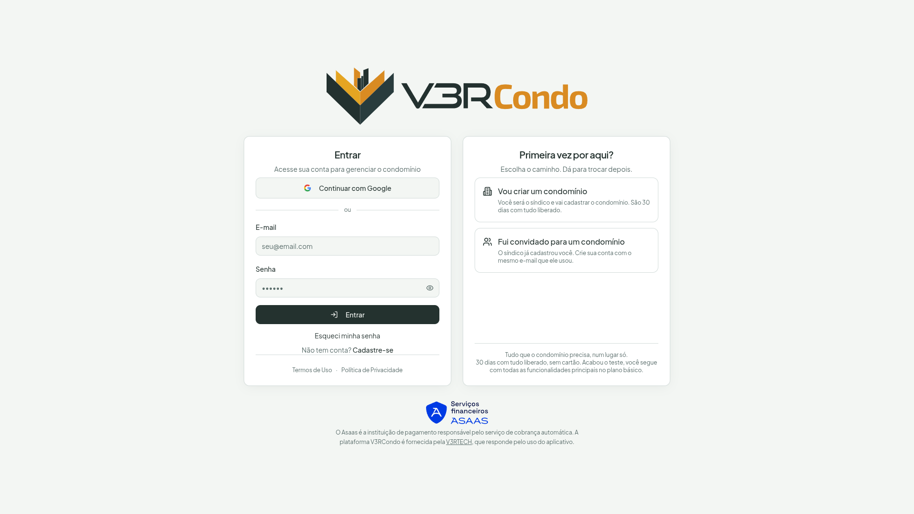
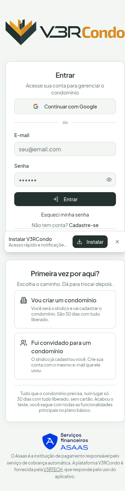
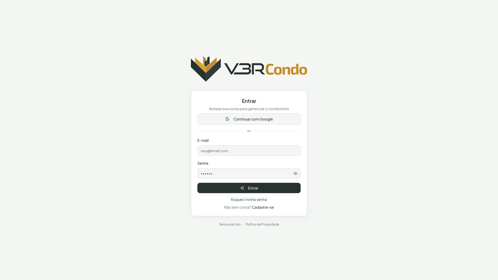
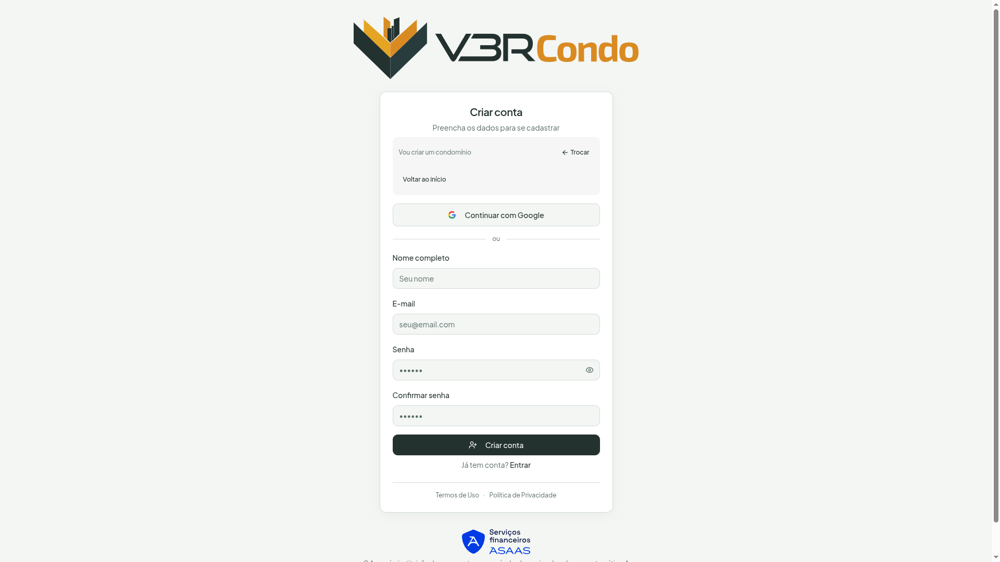
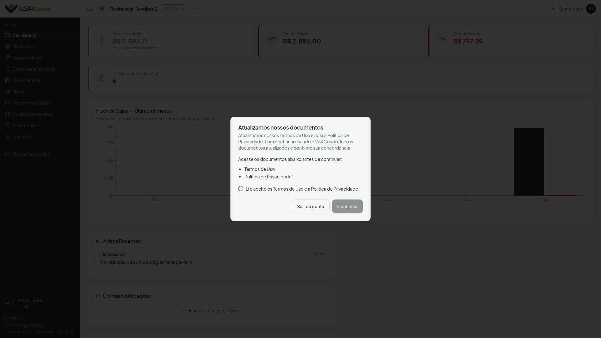
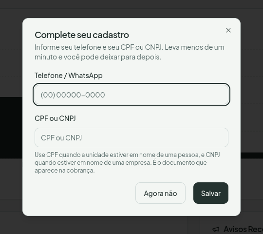
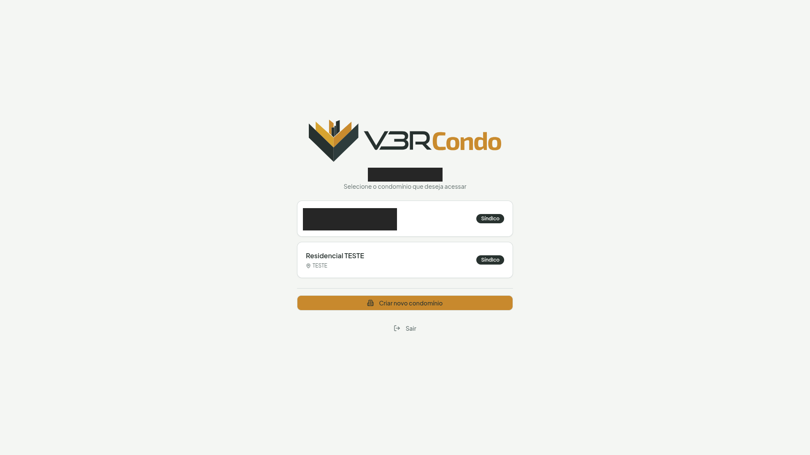
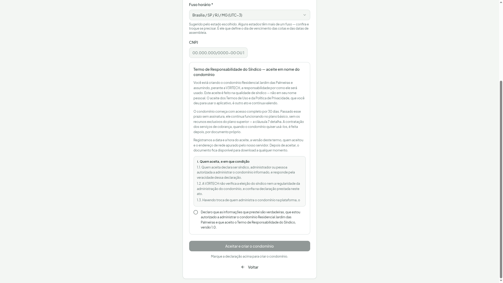
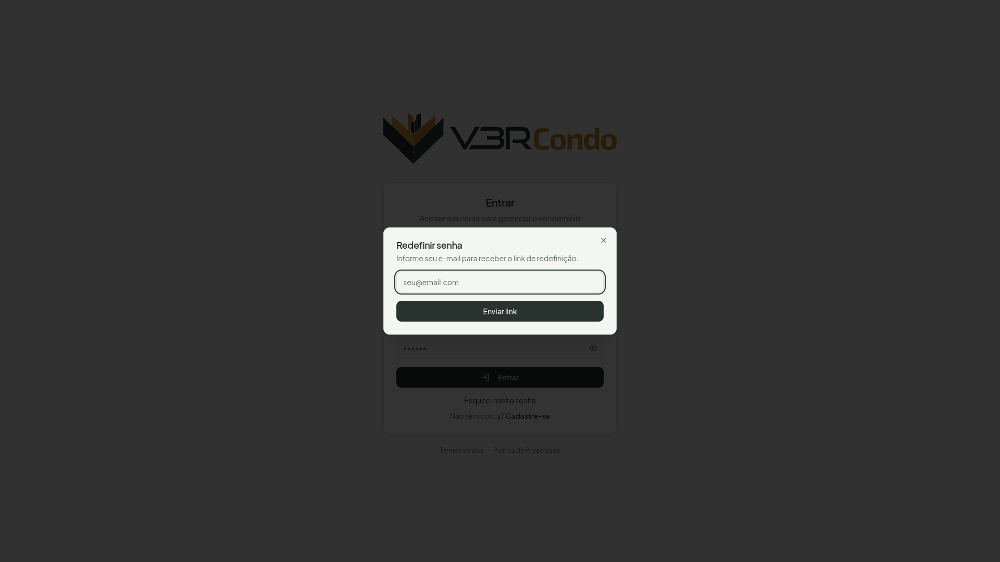

# Primeiros Passos



## Acessar o V3RCondo

Abra o navegador e acesse [app.v3rcondo.com.br](https://app.v3rcondo.com.br). A tela mostra, lado a lado, o formulário de **entrar** e um segundo cartão, **Primeira vez por aqui?**, com duas portas de entrada.

No celular, a mesma tela empilha em vez de dividir em colunas — o formulário de entrar primeiro, as portas logo abaixo:

{: .tip }
> **Prefere entrar direto pelo ícone, sem abrir o navegador?**
>
> Dá para instalar o V3RCondo como aplicativo no celular ou no computador —
> veja [Instalar como Aplicativo](/guia/instalar-app/).

## Fazer login

Se você já tem conta, use o cartão **Entrar**:

- **E-mail e senha** — informe seu e-mail e senha cadastrados
- **Continuar com Google** — autenticação rápida com a sua conta Google

## Criar conta: escolha a porta certa

Se você ainda não tem conta, o cartão **Primeira vez por aqui?** oferece duas portas — escolha a que descreve a sua situação:

- **Vou criar um condomínio** — você vai ser o síndico e cadastrar o condomínio do zero. São **30 dias com tudo liberado** a partir da liberação do condomínio pela administração, sem cartão de crédito
- **Fui convidado para um condomínio** — o síndico já cadastrou você. Crie sua conta com o **mesmo e-mail** que ele usou ao te cadastrar. **Recebeu um link ou um QR do condomínio?** Comece por ele: abra o link e siga as instruções (veja [abaixo](#depois-de-escolher-fui-convidado-para-um-condomínio))

{: .tip }
> **A escolha é reversível**
>
> Depois de escolher, o formulário de cadastro mostra um selo com a porta escolhida e o botão **Trocar**, para mudar de porta sem perder o que você já digitou. **Voltar ao início** leva de volta ao formulário de entrar, se você perceber que já tem conta.

{: .note }
> **O que você digitou não se perde**
>
> Nome e e-mail já preenchidos no cadastro ficam guardados neste navegador por algumas horas — se a página recarregar sem querer, você não começa do zero. O rascunho **nunca guarda senha** e some sozinho depois de um tempo ou assim que o cadastro é concluído. Em navegador de uso compartilhado (portaria, computador da administração), isso significa que o rascunho de quem usou antes de você já não estará mais lá depois de algumas horas.

## Aceitar os Termos de Uso e a Política de Privacidade

Logo depois de entrar, pode aparecer um aviso pedindo que você **leia e aceite** os documentos do V3RCondo. Ele aparece em duas situações: no seu **primeiro acesso** e sempre que os documentos forem **atualizados**.

**É agora o caso de todo mundo.** Publicamos os **Termos de Uso 1.3** e a **Política de Privacidade 1.2**, e por isso todo usuário vê o aviso no próximo acesso, ainda que já tivesse aceitado antes. **Não é erro nem problema na sua conta** — é o re-aceite da versão nova, e acontece uma vez só.

O que fazer:

1. Abra os dois links — **Termos de Uso** e **Política de Privacidade** — e leia. Eles abrem em outra aba, sem fechar o aviso
2. Marque **Li e aceito os Termos de Uso e a Política de Privacidade**
3. Clique em **Continuar**

O aviso **não fecha sem o aceite** — não dá para dispensá-lo clicando fora nem apertando *Esc*, porque o aceite é condição para usar o aplicativo. Mas ele não é um beco sem saída: há sempre o botão **Sair da conta**, se você preferir decidir depois.

{: .note }
> **Se algo der errado no meio do caminho**
>
> Se não conseguirmos confirmar seu aceite — falha de rede, por exemplo —, o aviso diz isso com todas as letras e oferece **Tentar de novo**, em vez de deixar você preso numa tela que não responde. Se insistir, saia da conta e entre outra vez. Nunca liberamos o acesso "no escuro": na dúvida sobre o que você já aceitou, o aviso continua.

Os documentos ficam sempre disponíveis, para consulta a qualquer momento, em [Contrato de Prestação de Serviços](/legal/contrato/), [Termos de Uso](/legal/termos/) e [Política de Privacidade](/legal/privacidade/).

{: .note }
> **Isto não é o Contrato de Prestação de Serviços**
>
> São **dois aceites diferentes**, e vale saber qual é qual. Os **Termos de Uso** e a **Política de Privacidade**, deste passo, são aceitos por **cada pessoa** que usa o aplicativo — síndico, condômino ou porteiro — e é o que acabamos de descrever aqui. Já o **Contrato de Prestação de Serviços** é aceito **uma única vez, só pelo síndico**, em nome do condomínio, em [Configurações → Condomínio](/modulos/configuracoes/). O condômino nunca vê esse segundo aceite nem precisa fazer nada a respeito dele.

## Complete seu cadastro

Pouco depois de entrar, pode aparecer uma janela pedindo seu **telefone** e
seu **CPF ou CNPJ** — desde que algum dos dois ainda esteja em branco no seu
[Meu Perfil](/modulos/perfil/). Vale para qualquer papel: síndico, condômino
ou porteiro. A janela só aparece para quem participa de pelo menos um condomínio:
quem acabou de responder **Não reconheço** à única inclusão que tinha não a vê.

Esses dois dados são usados para identificar você em documentos gerados pelo
sistema — acordo de parcelamento, notificação extrajudicial, extrato — e é
por isso que vale a pena preencher: um cadastro incompleto pode atrasar a
emissão desses documentos quando chegar a hora.

O que fazer:

1. Informe o **telefone/WhatsApp** e o **CPF ou CNPJ**
2. Clique em **Salvar** — ou em **Agora não**, se preferir deixar para depois

{: .tip }
> **Não é obrigatório, e não insiste toda vez**
>
> Clicando em **Agora não**, a janela fecha e não volta a aparecer nessa
> mesma visita, mesmo trocando de tela. Enquanto o cadastro continuar
> incompleto, ela pode aparecer de novo, mas **no máximo uma vez por
> semana** — em qualquer aparelho que você use para entrar. Completando o
> cadastro (aqui ou depois, por Meu Perfil), ela some de vez.

## Selecionar o condomínio

Se você pertence a mais de um condomínio, após o login o sistema exibe uma tela de seleção. Clique no condomínio que deseja acessar. Você pode trocar de condomínio a qualquer momento clicando na logo (ou no nome, se não houver logo) no cabeçalho do aplicativo — é o seletor de condomínio, com uma seta ao lado.

## Depois de escolher "Vou criar um condomínio"

Preencha os dados básicos e o condomínio é criado em instantes. Os **30 dias com tudo liberado** (plano Pro completo) antes de precisar assinar — sem cartão de crédito — **começam quando a administração libera o condomínio**, e não no dia da criação. Veja logo abaixo o que é essa liberação.

Faz parte da criação aceitar o **Termo de Responsabilidade do Síndico**, que trata da sua responsabilidade como administrador do condomínio na plataforma. É um aceite diferente dos Termos de Uso: veja [Termo de Responsabilidade do Síndico](/legal/termo-sindico/) para o texto completo e o que ele cobre.

### Todo condomínio novo passa por uma análise antes de alcançar moradores

**Por que isso existe.** O V3RCondo envia e-mails, avisos e cobranças em nome do condomínio. Para que ninguém use um condomínio inventado para escrever a terceiros, a administração da plataforma confirma que o condomínio é real antes de ele alcançar pessoas de fora. Para você, síndico de verdade, é um passo único e rápido de cumprir.

**O que funciona durante a análise:** toda a configuração interna — unidades, categorias, contas bancárias e Financeiro. **O que espera a liberação:** incluir moradores, enviar avisos e abrir a conta de cobrança. Uma faixa no topo do aplicativo lembra disso enquanto o pedido não for liberado.

**O que você faz:** abra **Configurações → Liberação** e envie o pedido. Os detalhes — CNPJ ou CPF, comprovante, o que fazer se o pedido não for aprovado — estão em [Configurações → Liberação](/modulos/configuracoes/#aba-liberação-síndico). A resposta chega por e-mail.

{: .tip }
> **Envie o pedido no primeiro dia**
>
> O teste grátis só começa na liberação. Quanto mais cedo você pedir, mais cedo o condomínio chega aos moradores e o relógio do teste começa a andar. Enquanto espera, aproveite para cadastrar unidades e categorias.

{: .note }
> **As unidades são cadastradas depois, não na criação**
>
> O formulário de criação **não pede o número de unidades**. Depois de criar o condomínio, cadastre as unidades em **Configurações → Unidades** — é esse cadastro que alimenta o painel, o cálculo do plano e tudo que depende de "quantas unidades o condomínio tem". Elas também são o catálogo que a [importação de lançamentos por planilha](/modulos/financeiro/#importar-lançamentos-em-lote-síndico) reconhece: cadastre as unidades antes de importar um histórico que cite unidade.

{: .tip }
> **Confira o fuso horário**
>
> O formulário sugere um fuso a partir do estado informado, mas o campo é **visível e pode ser trocado**. É esse fuso que define o dia de vencimento das cotas e as datas de assembleia — confira se o condomínio fica fora do fuso de Brasília antes de confirmar.

## Depois de escolher "Fui convidado para um condomínio"

Para condôminos cujo condomínio já está cadastrado. **Não existe busca de condomínio pelo nome:** quem entra por conta própria usa o **link** (ou o **QR**) que o síndico gera para o condomínio. Peça o link ao seu síndico; ele costuma mandar pelo grupo do condomínio ou deixar o QR impresso no mural.

**Por que é assim.** O condomínio só aparece para quem tem o link. Sem busca, um estranho não consegue descobrir que o seu prédio usa o V3RCondo nem tentar entrar nele — e o síndico ainda confere a unidade de cada pedido antes de aprovar.

1. **Abra o link** (ou aponte a câmera do celular para o QR). A página diz **Você foi convidado para pedir entrada em** e mostra só o **nome, a cidade e o estado** do condomínio, para você conferir que é o certo.
2. **Entre ou crie a sua conta.** Na página do link, **Entrar** e **Criar conta** levam à mesma tela de entrada do V3RCondo. Quem já tem conta usa o cartão **Entrar**. Quem ainda não tem escolhe, no cartão **Primeira vez por aqui?**, a porta **Fui convidado para um condomínio** e preenche o cadastro. Logo depois de entrar, você volta para a mesma página do link.
3. **Confirme o seu e-mail, se a página pedir.** Enquanto o e-mail não estiver confirmado, a página mostra *Confirme seu e-mail antes de pedir a entrada*. Abra a mensagem de confirmação na sua caixa de entrada e clique no link dela; você volta ao link do condomínio.
4. **Informe a sua unidade.** No campo **Sua unidade**, escolha na lista, se o condomínio já tem as unidades cadastradas; se não tem, digite (por exemplo, *Apto 101, Bloco A*; até 40 caracteres).
5. **Clique em Pedir para entrar.** A página responde **Pedido enviado**. O síndico recebe um e-mail e confere a unidade antes de aprovar; você recebe um e-mail quando ele decidir. O botão **Acompanhar pedido** leva à tela de escolha de condomínio.

Enquanto espera, o pedido aparece no bloco **Seus pedidos de entrada**, na tela de escolha de condomínio, como **Aguardando o síndico**. Se o síndico recusar, aparece **Recusado**; se aprovar, você entra no condomínio.

**Exemplo.** Marina, do apartamento 302 do Edifício Aurora, fotografa o QR do mural, cria a conta, escolhe **302** na lista e clica em **Pedir para entrar**. Duas horas depois chega o e-mail *Seu pedido para entrar no condomínio foi aprovado*; ela abre o V3RCondo e já vê o condomínio, sem passar pela janela **Confirmar / Não reconheço**.

{: .note }
> **Limites e situações comuns**
>
> - Cada pessoa pode fazer até **5 pedidos em 24 horas**. Passando disso, o aplicativo avisa *Você já fez 5 pedidos nas últimas 24 horas. Tente novamente amanhã.*
> - Cada condomínio comporta até **30 pedidos aguardando**. Se o limite foi atingido, o aplicativo avisa *Este condomínio tem muitos pedidos aguardando o síndico*. Fale com o síndico para ele decidir os pedidos que já estão na fila.
> - **"Este link não está disponível. Peça o link atual ao síndico."** quer dizer que o síndico trocou ou desativou o link, ou que o condomínio está temporariamente indisponível. Peça o link atual a ele.
> - **"Muitas tentativas a partir desta rede"**: a mesma rede abriu muitos links em poucos minutos. Aguarde alguns minutos e clique em **Tentar de novo**.
> - Quem **já faz parte** do condomínio vê *Você já está vinculado a este condomínio* e o botão **Abrir o condomínio**. Quem **já pediu** vê *Você já pediu para entrar. Aguarde a resposta do síndico.*
> - Quando o síndico aprova, você entra **já confirmado**: a janela **Confirmar / Não reconheço** não aparece, porque foi você quem pediu para entrar.
> - **Recusado não é o fim.** Se foi engano, fale com o síndico e abra o link de novo: o pedido novo conta nos 5 das 24 horas.

{: .warning }
> **Confirmou o e-mail em outro navegador ou depois de um dia? Abra o link de novo**
>
> O aplicativo guarda o endereço do link por **24 horas, neste navegador**, para levar você de volta depois da confirmação do e-mail. Se você abriu a mensagem de confirmação em outro aparelho, ou deixou passar mais de um dia, você cai na tela de boas-vindas (com as opções **Criar meu condomínio** e **Solicitar vínculo**) em vez de voltar ao link: abra o link do síndico de novo e continue de lá.

{: .note }
> **Já faz parte de outro condomínio?**
>
> Quem já tem exatamente um condomínio entra direto nele e **não vê** o bloco **Seus pedidos de entrada**. O resultado do novo pedido chega por e-mail; depois de aprovado, ele passa a aparecer na escolha de condomínio.

**E se você abrir a tela de vínculo sem link?** Na tela de escolha de condomínio, o cartão **Solicitar vínculo** (botão **Como entrar**) não busca nada: só orienta *Para entrar no condomínio, peça o link ao síndico.*

{: .tip }
> **Convite por e-mail**
>
> Se você recebeu um convite por e-mail do seu síndico, clique no link do e-mail e siga as instruções para definir sua senha. O vínculo será feito automaticamente. Na tela de criar a senha você marca o aceite dos Termos de Uso e da Política de Privacidade; esse aceite fica registrado e o aplicativo não pede o mesmo aceite de novo logo depois. Ao entrar, o aplicativo pergunta se você reconhece a inclusão no condomínio (**Confirmar** ou **Não reconheço**); até você responder, o síndico não vê seus dados de cadastro.

## Recuperar a senha

Na tela de login, clique em **Esqueci minha senha** e informe seu e-mail. Você receberá um link para redefinir a senha.

{: .note }
> **Login com Google**
>
> Usuários que entram com o Google não precisam definir senha — o acesso é gerenciado pela conta Google.
